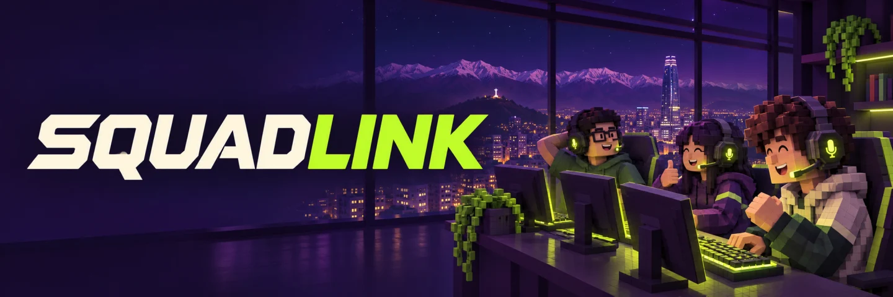

# Squadlink

Sala de voz para tu grupo de hasta **cinco jugadores**. Elige un apodo, comparte un código y conversa mientras juegan. Abre Arcade para jugar en la misma ventana mientras sigues en la sala de voz.

**[Descargar Squadlink](https://squadlink-lobby.onrender.com/descargar.html)**

Para jugar mientras hablas, usa **Ajustes → Rendimiento → Bajo consumo**. Está activo de forma predeterminada. Con una llamada activa, Squadlink libera la vista del lobby al abrir la sala o al minimizar el lobby. Puedes restaurar la ventana y seguir en la misma llamada con la radio que elegiste.

Desde **0.5.0-preview.20**, abre **Ajustes → Actualizaciones**. Cuando haya una versión nueva, pulsa **Descargar actualización**. Puedes seguir en la llamada mientras se descarga. Sal de la sala y pulsa **Instalar y reiniciar** cuando estés listo. Squadlink vuelve a abrirse con tu perfil y conserva los cartuchos instalados. Si tienes la .19 o una versión anterior, instala esta primera actualización con la descarga de arriba.

A partir de la .21 puedes cancelar una descarga durante una llamada. Cuando una descarga termine, puedes cerrar Squadlink y volver a **Ajustes** más tarde para instalarla. La aplicación comprueba el archivo guardado. Si el almacén seguro del equipo está disponible, también puedes instalarlo sin conexión.

Elige Windows x64 o Mac con Apple Silicon. En Windows, ejecuta el instalador. En Mac, extrae el ZIP y mueve Squadlink a Aplicaciones. La app para Mac tiene firma local y carece de notarización de Apple.

El arcade incluye Cambio de blanco, Precisión, Mata patos, 2048 y Tres en raya. Estos juegos se ejecutan en el dispositivo. En DOOM puedes jugar la campaña libre Freedoom: Phase 1 con Chocolate Doom. Pulsa **Cargar DOOM** para descargar el juego (unos 35 MB la primera vez) y luego **Jugar**. Usa WASD para moverte, el ratón para girar, clic izquierdo para disparar y Espacio para abrir puertas. Esc libera el cursor. Salir del juego detiene su audio y conserva la llamada. [Proyecto de Chocolate Doom y Freedoom para navegador](https://github.com/danborden1/doom-web)

En **Arcade**, la copia personal abre los cartuchos instalados de Mario y Mata patos con **Enter**. En el instalador personal de Windows, abre el único EXE para instalar el programa y ambos cartuchos juntos. En la edición pública, elige tu archivo .nes una vez por juego y equipo. Al volver a Arcade se abre la copia guardada en ese perfil. En Mario, usa las flechas para moverte, Espacio o Z para saltar y X para correr. En Duck Hunt, pulsa Enter para empezar, apunta con el ratón y dispara con clic. Pulsa P para pausar.

En **Mi sala → Radio y música → Añadir música** puedes compartir una emisora por género o un archivo de audio de hasta 20 MiB. Mientras suena la música, **Silenciar solo para mí** apaga la reproducción en tu equipo. **Escuchar aquí** la reanuda. El atajo **Alt + Mayús + R** (Mac **⌥ ⇧ R**) alterna la radio individual. También puedes pulsar el botón de radio del lobby. En escritorio el atajo funciona durante la llamada con la ventana minimizada cuando el sistema permite registrar la combinación. En el navegador úsalo con la pestaña activa. La sala y los demás oyentes siguen con la misma emisora. El volumen de la música se recuerda en tu equipo. La música y la llamada continúan al minimizar la ventana de escritorio. Si cambias de ventana durante Mario o Mata patos, el juego entra en pausa. Pulsa **P** al volver para reanudar. La guía de escritorio explica cómo guardar el pase de jugador, cambiar el rostro y escuchar la radio. [Personaje y radio](docs/personaje-y-radio-mac.md)

## La primera partida

1. Abre Squadlink y elige tu apodo. El dispositivo lo recuerda para la próxima sesión.
2. Pulsa **Crear sala** y escribe un nombre. **Mostrar en Salas públicas** está activado al crearla. Desmárcalo si prefieres compartirla solo por código o invitación. Puedes exigir una clave incluso en una sala publicada y añadir juego, nivel y descripción.
3. Comparte el **código de sala** de seis caracteres. Tu amigo abre **Unirme con código** en el mismo lobby e introduce el código y la clave, si la configuraste.
4. Si falla la conexión inicial de voz, pulsa **Reintentar conexión de voz** en la misma sala. Cada jugador pulsa **Activar micrófono** y concede el permiso. En los ajustes de voz puede elegir micrófono y salida, activar reducción de ruido y consultar el diagnóstico cuando el dispositivo lo admite.

| Crear la sala | Entrar con el código |
| --- | --- |
|  |  |

## Qué puede hacer el grupo

| Función | Cómo se usa |
| --- | --- |
| Amigos y presencia | Intercambien códigos de amigo y acepten la solicitud. Pueden ver quién está conectado, a qué juega y desde cuándo está en la sala. Un amigo puede pedir entrar y el anfitrión decide. |
| Directorio | Explora las salas publicadas por sus anfitriones. El código de partida del videojuego se comparte dentro de la sala. Es distinto del código de Squadlink. |
| Detección de juegos | El cliente de Windows permite activar la detección de VALORANT, Counter-Strike 2, Rocket League, Fortnite, League of Legends, Dota 2 y Overwatch 2. En la web puedes indicar el juego a mano. |
| Personaje y arcade | Personaliza piel, ropa y accesorios. Cada 100 XP subes un nivel. Reflejos premia los tiempos más cortos y Memoria las secuencias más largas. Reflejos y Memoria tienen clasificaciones en línea. |
| Modo partida | Reduce el lobby a los controles de voz mientras juegas. |

La identidad de invitado y los contactos se recuperan desde el mismo perfil del dispositivo. Borrar los datos de la app puede hacerte perder acceso a esa identidad. Un reinicio del lobby cierra las salas y sus códigos. El progreso del piloto compartido se guarda en PostgreSQL.

## Estado del piloto

**El 23 de noviembre de 2026** se verificó audio sintético en ambos sentidos entre dos clientes a través del relay de Santiago por UDP y TCP. El piloto regional tiene apagado programado para el **24 de noviembre a las 00:14, hora de Perú**. Las conexiones directas pueden seguir funcionando después del apagado. Las redes que requieren un relay volverán a necesitar uno activo. [Resultado de la prueba de voz](https://github.com/reyzongian2026-creator/squadlink/actions/runs/45117399894)

Para uso permanente quedan por definir el alojamiento continuo del relay y la continuidad de PostgreSQL antes del **22 de diciembre de 2026**, cuando vence la base gratuita del piloto. Falta medir CPU, RAM, FPS y calidad de voz en partidas reales desde Perú, Chile y Argentina en PCs de gama baja. La [corrección del micrófono al cambiar de entrada](https://github.com/reyzongian2026-creator/squadlink/pull/1) se sigue por separado.

Al elegir una emisora, verás su consumo aproximado por hora. Tech House y Power 181 rondan los 58 MB por hora. SUNSHINE LIVE EDM ronda los 29 MB. Estas cifras corresponden al audio de la radio y dependen de la tasa que envía la emisora.

## Si algo falla

| Síntoma | Qué revisar |
| --- | --- |
| Quiero comprobar si el ruido viene de mi equipo | Antes de entrar a una sala, abre **Ajustes de audio** y pulsa **Grabar prueba de 4 segundos**. Deja un segundo de silencio y luego habla como en una llamada. Pulsa **Escuchar mi prueba** para oír la muestra local con tu volumen de escucha. |
| No sé por dónde sale el sonido | En los mismos ajustes, selecciona una salida y pulsa **Probar altavoz**. Oirás dos tonos en ese dispositivo. |
| Oigo cortes solo con un compañero | En la sala, pulsa **Medir conexión de voz** mientras habla. Revisa la pérdida de paquetes, la variación del tiempo de llegada (*jitter*) y el tiempo de ida y vuelta junto a su apodo. Repite la medición cuando oigas el corte. |
| El código de sala no funciona | Comprueba que ambos estén en el mismo servidor, que quede un cupo y que el anfitrión siga en la sala o haya otro miembro conectado. Tras un reinicio hay que crear una sala nueva. |
| Todos tienen el volumen al máximo y la voz llega baja | En **Ajustes → Dispositivos de audio**, sube **Volumen de las voces que escucho** a 150 % y ajusta hasta 200 % según necesites. Si tus compañeros te oyen bajo, sube **Ganancia de mi micrófono** desde 0 dB a +6 dB y comprueba el resultado en la llamada. |
| Se oye un siseo entre frases o las voces llegan muy fuertes | Ambos jugadores pueden abrir **Ajustes → Dispositivos de audio → Restablecer volumen y filtros de voz**. Esto deja la reducción de ruido activa, la ganancia automática desactivada y el volumen de escucha al 70 %. Cada uno conserva el micrófono y la salida elegidos. |
| Entran a la sala, pero no se oyen | Comprueben el permiso del micrófono, los dispositivos elegidos y el diagnóstico de conexión. Si en redes separadas falla, revisen la disponibilidad del relay. |

## Desarrollo, pruebas y operación

Para ejecutar el proyecto localmente, usa Node.js 22 o superior, instala las dependencias con `npm ci` y ejecuta `npm start`. Abre `http://localhost:4179`. Las instrucciones para Docker, compilación de Windows, pruebas de navegador y recuperación están en la [guía de desarrollo y operación](docs/operacion.md).

[Arquitectura del lobby](docs/architecture/lobby.md) · [Progreso y rankings](docs/architecture/progreso.md) · [Voz en Santiago](ops/santiago/README.md) · [Controles de seguridad](docs/security/lobby.md) · [Pruebas de aceptación](docs/qa/lobby.md)

