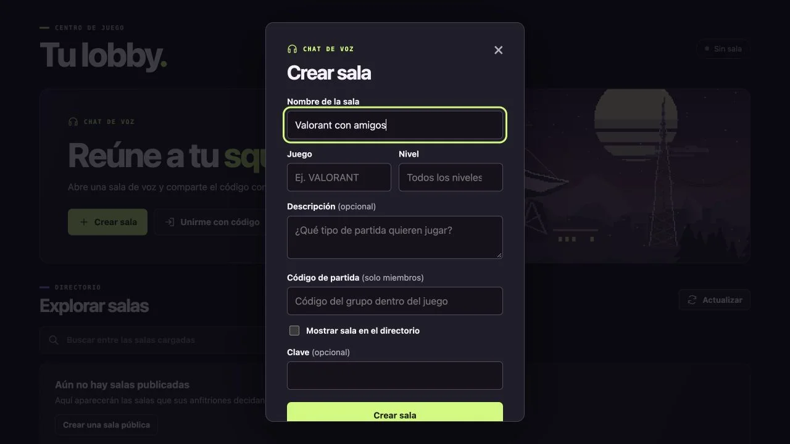
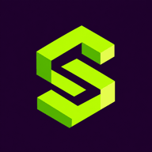

# Squadlink

Sala de voz para tu grupo de hasta **cinco jugadores**. Elige un apodo, comparte un código y conversa mientras juegan. Abre Arcade para jugar en la misma ventana mientras sigues en la sala de voz.

**[Descargar Squadlink](https://squadlink-lobby.onrender.com/descargar.html)**

Elige Windows x64 o Mac con Apple Silicon. En Windows, ejecuta el instalador. En Mac, extrae el ZIP y mueve Squadlink a Aplicaciones. La app para Mac tiene firma local y carece de notarización de Apple.

El arcade incluye Cambio de blanco, Precisión, Mata patos, 2048 y Tres en raya. Estos juegos se ejecutan en el dispositivo. En DOOM puedes jugar la campaña libre Freedoom: Phase 1 con Chocolate Doom. Pulsa **Cargar DOOM** para descargar el juego (unos 35 MB la primera vez) y luego **Jugar**. Usa WASD para moverte, el ratón para girar, clic izquierdo para disparar y Espacio para abrir puertas. Esc libera el cursor. Salir del juego detiene su audio y conserva la llamada. [Proyecto de Chocolate Doom y Freedoom para navegador](https://github.com/danborden1/doom-web)

En **Arcade**, selecciona tu cartucho NES. En Mario, usa las flechas para moverte, Espacio o Z para saltar y X para correr. En Duck Hunt, pulsa Enter para empezar, apunta con el ratón y dispara con clic. Pulsa P para pausar.

En **Mi sala → Radio y música → Añadir música** puedes compartir una emisora por género o un archivo de audio de hasta 20 MiB. Cada jugador controla su volumen. La guía de escritorio explica cómo guardar el pase de jugador, cambiar el rostro y escuchar la radio. [Personaje y radio](docs/personaje-y-radio-mac.md)

## La primera partida

1. Abre Squadlink y elige tu apodo. El dispositivo lo recuerda para la próxima sesión.
2. Pulsa **Crear sala** y escribe un nombre. **Mostrar en Salas públicas** está activado al crearla. Desmárcalo si prefieres compartirla solo por código o invitación. Puedes exigir una clave incluso en una sala publicada y añadir juego, nivel y descripción.
3. Comparte el **código de sala** de seis caracteres. Tu amigo abre **Unirme con código** en el mismo lobby e introduce el código y la clave, si la configuraste.
4. Cada jugador pulsa **Activar micrófono** y concede el permiso. En los ajustes de voz puede elegir micrófono y salida, activar reducción de ruido y consultar el diagnóstico cuando el dispositivo lo admite.

| Crear la sala | Entrar con el código |
| --- | --- |
|  |  |

## Qué puede hacer el grupo

| Función | Cómo se usa |
| --- | --- |
| Amigos y presencia | Intercambien códigos de amigo y acepten la solicitud. Pueden ver quién está conectado, a qué juega y desde cuándo está en la sala. Un amigo puede pedir entrar y el anfitrión decide. |
| Directorio | Explora las salas publicadas por sus anfitriones. El código de partida del videojuego se comparte dentro de la sala. Es distinto del código de Squadlink. |
| Detección de juegos | El cliente de Windows permite activar la detección de VALORANT, Counter-Strike 2, Rocket League, Fortnite, League of Legends, Dota 2 y Overwatch 2. En la web puedes indicar el juego a mano. |
| Personaje y arcade | Personaliza piel, ropa y accesorios. Cada 100 XP subes un nivel. Reflejos premia los tiempos más cortos y Memoria las secuencias más largas. Reflejos y Memoria tienen clasificaciones en línea. |
| Modo partida | Reduce el lobby a los controles de voz mientras juegas. |

La identidad de invitado y los contactos se recuperan desde el mismo perfil del dispositivo. Borrar los datos de la app puede hacerte perder acceso a esa identidad. Un reinicio del lobby cierra las salas y sus códigos. El progreso del piloto compartido se guarda en PostgreSQL.

## Estado del piloto

**El 23 de noviembre de 2026** se verificó audio sintético en ambos sentidos entre dos clientes a través del relay de Santiago por UDP y TCP. El piloto regional tiene apagado programado para el **24 de noviembre a las 00:14, hora de Perú**. Las conexiones directas pueden seguir funcionando después del apagado. Las redes que requieren un relay volverán a necesitar uno activo. [Resultado de la prueba de voz](https://github.com/reyzongian2026-creator/squadlink/actions/runs/45117399894)

Para uso permanente quedan por definir el alojamiento continuo del relay y la continuidad de PostgreSQL antes del **22 de diciembre de 2026**, cuando vence la base gratuita del piloto. Falta medir CPU, RAM, FPS y calidad de voz en partidas reales desde Perú, Chile y Argentina en PCs de gama baja. La [corrección del micrófono al cambiar de entrada](https://github.com/reyzongian2026-creator/squadlink/pull/1) se sigue por separado.

## Si algo falla

| Síntoma | Qué revisar |
| --- | --- |
| El código de sala no funciona | Comprueba que ambos estén en el mismo servidor, que quede un cupo y que el anfitrión siga en la sala o haya otro miembro conectado. Tras un reinicio hay que crear una sala nueva. |
| Entran a la sala, pero no se oyen | Comprueben el permiso del micrófono, los dispositivos elegidos y el diagnóstico de conexión. Si en redes separadas falla, revisen la disponibilidad del relay. |

## Desarrollo, pruebas y operación

Para ejecutar el proyecto localmente, usa Node.js 22 o superior, instala las dependencias con `npm ci` y ejecuta `npm start`. Abre `http://localhost:4179`. Las instrucciones para Docker, compilación de Windows, pruebas de navegador y recuperación están en la [guía de desarrollo y operación](docs/operacion.md).

[Arquitectura del lobby](docs/architecture/lobby.md) · [Progreso y rankings](docs/architecture/progreso.md) · [Voz en Santiago](ops/santiago/README.md) · [Controles de seguridad](docs/security/lobby.md) · [Pruebas de aceptación](docs/qa/lobby.md)

