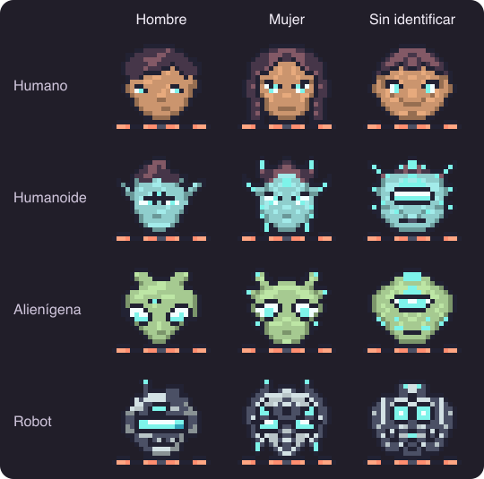
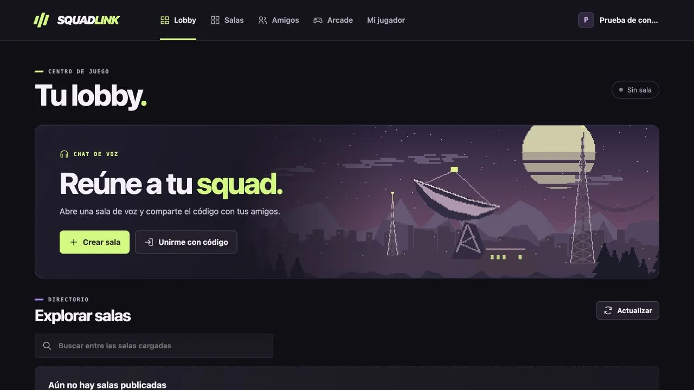
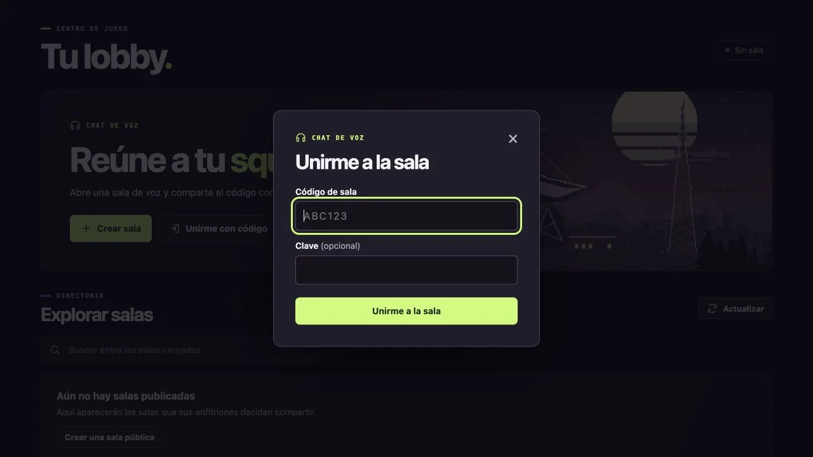

# Squadlink

Sala de voz para tu grupo de hasta **cinco jugadores**. Elige un apodo, comparte un código y conversa mientras juegan. Abre Arcade para jugar en la misma ventana mientras sigues en la sala de voz.

**[Abrir Squadlink en la web](https://squadlink-lobby.onrender.com/)** · [Descargar para Windows x64](https://github.com/reyzongian2026-creator/squadlink/releases/download/moderno-v0.5.0-preview.7/Squadlink-Moderno-Setup-x64.exe) · [Descargar para Mac con Apple Silicon](https://github.com/reyzongian2026-creator/squadlink/releases/download/moderno-v0.5.0-preview.7/Squadlink-Moderno-macOS-arm64.zip)

El arcade incluye Cambio de blanco, Precisión, Mata patos, 2048 y Tres en raya. Estos juegos se ejecutan en el dispositivo. En DOOM puedes jugar la campaña libre Freedoom: Phase 1 con Chocolate Doom. Pulsa **Cargar DOOM** para descargar el juego (unos 35 MB la primera vez) y luego **Jugar**. Usa WASD para moverte, el ratón para girar, clic izquierdo para disparar y Espacio para abrir puertas. Esc libera el cursor. Salir del juego detiene su audio y conserva la llamada. [Proyecto de Chocolate Doom y Freedoom para navegador](https://github.com/danborden1/doom-web)

En **Arcade → Duck Hunt · NES** selecciona tu cartucho `.nes` y pulsa **Jugar**. Usa **Select** y **Start** para entrar a una partida y dispara con clic o toque. El archivo se procesa en tu dispositivo.

En los clientes con el selector de YouTube, abre **Mi sala → Música de sala → Añadir música** y elige un archivo de audio (hasta 20 MiB) o pega el enlace de un video de YouTube. **DJ Squadlink** muestra qué suena y conserva el orden de la cola. Cada integrante pulsa **Escuchar** y ajusta su volumen. Los archivos se comparten dentro de la sala y el servidor los elimina al salir de la cola o al cerrarse la sala. Los videos requieren que YouTube permita su reproducción insertada y que el reproductor esté visible.

Squadlink Moderno 0.5.0-preview.7 abre el lobby, los amigos, el arcade y los ajustes en la misma ventana. En Windows, ejecuta el instalador. En Mac, extrae el ZIP y mueve la app a Aplicaciones. La versión de Mac lleva firma local y carece de notarización de Apple. [Ver la versión y sus sumas SHA-256](https://github.com/reyzongian2026-creator/squadlink/releases/tag/moderno-v0.5.0-preview.7)

**[Descargar el instalador de Windows x64](https://github.com/reyzongian2026-creator/squadlink/releases/latest/download/Squadlink-Setup-x64.exe)** · **[Abrir el lobby web](https://squadlink-lobby.onrender.com/)** · [Versiones y SHA-256](https://github.com/reyzongian2026-creator/squadlink/releases/latest)

El instalador es público y se puede descargar sin iniciar sesión en GitHub. Tus amigos también pueden entrar desde el enlace web. El cliente de Windows se instala para el usuario actual, utiliza Microsoft Edge WebView2 Runtime y abre el lobby compartido. Los jugadores de Windows y del navegador pueden estar en la misma sala.

## Personaje y radio en Mac · preview.13

Esta sección corresponde a la compilación de prueba **0.5.0-preview.13** para Mac con Apple Silicon. Los enlaces de descarga de la parte superior apuntan a **preview.7**. Puedes comprobar tu versión en **Ajustes → Actualizaciones**.

### Elegir el rostro y guardar la apariencia

Abre **Mi personaje**. Cada especie (humano, humanoide, alienígena y robot) tiene tres rostros. Pulsa **Hombre**, **Mujer** o **Especie no identificada** para ver el cambio al instante. Puedes combinar cualquiera con la silueta, el vello facial y los accesorios que elijas. Mientras el editor muestra **Cambios sin guardar**, la selección es una vista previa. Pulsa **Guardar apariencia** para conservarla al cerrar la app. La primera vez, el botón te permite crear el personaje o elegir tu apodo.

En **Evoluciones** puedes consultar las siete etapas. Reflejos y Memoria conceden XP. Cada 100 XP se sube un nivel hasta el 50, que se alcanza con 4.900 XP. El aura dorada aparece en el nivel 10, la azul en el 30 y la prismática en el 50.

### Conservar el jugador al cambiar de apodo o de equipo

En **Mi personaje → Editar mi apodo** puedes cambiar el nombre y conservar el mismo jugador, XP, récords y amistades. Para trasladarte a otro equipo, selecciona **Guardar mi pase privado**. En la instalación nueva, elige **Abrir mi pase de jugador** antes de crear otro perfil. Quien tenga el archivo puede entrar como tú. Si pierdes todos los dispositivos y copias del pase, el apodo por sí solo no permite recuperar el acceso.

### Escuchar la radio en una sala

Abre **Radio y música → Añadir música → Radio en directo** y elige género y emisora. Por ejemplo, **Pop en inglés** ofrece Power 181, **Disco de los 80** ofrece 80s80s · Italo Disco y **Electrónica** ofrece Tech House y SUNSHINE LIVE · EDM. **Escuchar solo aquí** reproduce en tu equipo. **Añadir a la sala** comparte la emisora en la cola. Cada participante puede activar la escucha y ajustar su volumen.

Al reiniciar, el perfil y el progreso guardados siguen vinculados a tu jugador. Las salas son temporales. Si la última persona permanece desconectada y la sala caduca, su código deja de funcionar y hay que crear otra sala para continuar con la radio.

## La primera partida

1. Abre Squadlink y elige tu apodo. El dispositivo lo recuerda para la próxima sesión.
2. Pulsa **Crear sala** y escribe un nombre. **Mostrar en Salas públicas** está activado al crearla. Desmárcalo si prefieres compartirla solo por código o invitación. Puedes exigir una clave incluso en una sala publicada y añadir juego, nivel y descripción.
3. Comparte el **código de sala** de seis caracteres. Tu amigo abre **Unirme con código** en el mismo lobby e introduce el código y la clave, si la configuraste.
4. Cada jugador pulsa **Activar micrófono** y concede el permiso. En los ajustes de voz puede elegir micrófono y salida, activar reducción de ruido y consultar el diagnóstico cuando el dispositivo lo admite.

| Crear la sala | Entrar con el código |
| --- | --- |
|  |  |

## Qué puede hacer el grupo

| Función | Cómo se usa |
| --- | --- |
| Amigos y presencia | Intercambien códigos de amigo y acepten la solicitud. Pueden ver quién está conectado, a qué juega y desde cuándo está en la sala. Un amigo puede pedir entrar y el anfitrión decide. |
| Directorio | Explora las salas publicadas por sus anfitriones. El código de partida del videojuego se comparte dentro de la sala. Es distinto del código de Squadlink. |
| Detección de juegos | El cliente de Windows permite activar la detección de VALORANT, Counter-Strike 2, Rocket League, Fortnite, League of Legends, Dota 2 y Overwatch 2. En la web puedes indicar el juego a mano. |
| Personaje y arcade | Personaliza piel, ropa y accesorios. Cada 100 XP subes un nivel. Reflejos premia los tiempos más cortos y Memoria las secuencias más largas. Reflejos y Memoria tienen clasificaciones en línea. |
| Modo partida | Reduce el lobby a los controles de voz mientras juegas. |

La identidad de invitado y los contactos se recuperan desde el mismo perfil del dispositivo. Borrar los datos de la app puede hacerte perder acceso a esa identidad. Un reinicio del lobby cierra las salas y sus códigos. El progreso del piloto compartido se guarda en PostgreSQL.

## Estado del piloto

**El 23 de noviembre de 2026** se verificó audio sintético en ambos sentidos entre dos clientes a través del relay de Santiago por UDP y TCP. El piloto regional tiene apagado programado para el **24 de noviembre a las 00:14, hora de Perú**. Las conexiones directas pueden seguir funcionando después del apagado. Las redes que requieren un relay volverán a necesitar uno activo. [Resultado de la prueba de voz](https://github.com/reyzongian2026-creator/squadlink/actions/runs/45117399894)

Para uso permanente quedan por definir el alojamiento continuo del relay y la continuidad de PostgreSQL antes del **22 de diciembre de 2026**, cuando vence la base gratuita del piloto. Falta medir CPU, RAM, FPS y calidad de voz en partidas reales desde Perú, Chile y Argentina en PCs de gama baja. La [corrección del micrófono al cambiar de entrada](https://github.com/reyzongian2026-creator/squadlink/pull/1) se sigue por separado.

## Si algo falla

| Síntoma | Qué revisar |
| --- | --- |
| El enlace de descarga devuelve 404 | Inicia sesión en GitHub con una cuenta que tenga acceso o usa el lobby web. |
| El código de sala no funciona | Comprueba que ambos estén en el mismo servidor, que quede un cupo y que el anfitrión siga en la sala o haya otro miembro conectado. Tras un reinicio hay que crear una sala nueva. |
| Entran a la sala, pero no se oyen | Comprueben el permiso del micrófono, los dispositivos elegidos y el diagnóstico de conexión. Si en redes separadas falla, revisen la disponibilidad del relay. |
| Quiero verificar el instalador | Descarga también el archivo SHA256.txt de la misma versión. En PowerShell ejecuta `Get-FileHash .\Squadlink-Setup-x64.exe -Algorithm SHA256` y compara el valor. |

## Desarrollo, pruebas y operación

Para ejecutar el proyecto localmente, usa Node.js 22 o superior, instala las dependencias con `npm ci` y ejecuta `npm start`. Abre `http://localhost:4179`. Las instrucciones para Docker, compilación de Windows, pruebas de navegador y recuperación están en la [guía de desarrollo y operación](docs/operacion.md).

[Arquitectura del lobby](docs/architecture/lobby.md) · [Progreso y rankings](docs/architecture/progreso.md) · [Voz en Santiago](ops/santiago/README.md) · [Controles de seguridad](docs/security/lobby.md) · [Pruebas de aceptación](docs/qa/lobby.md)

