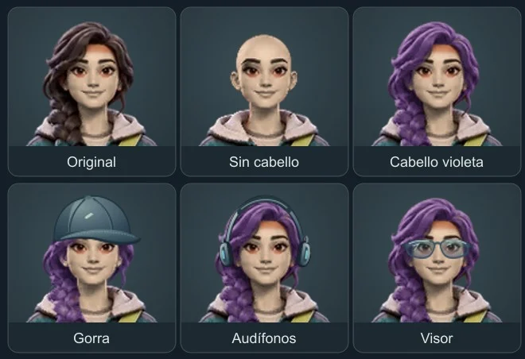
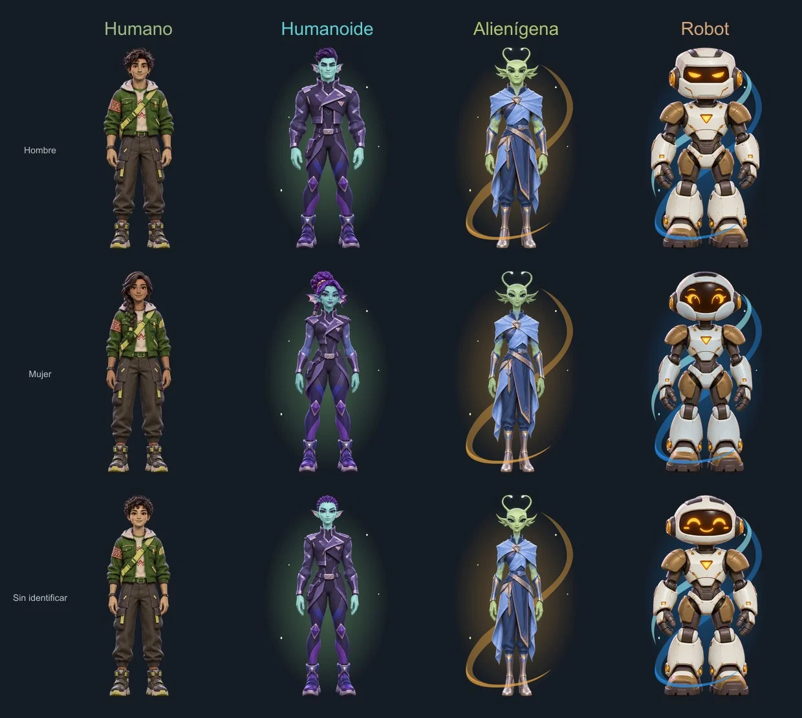

# Personaje y radio en Squadlink

Guía para Windows x64 y Mac con Apple Silicon. Puedes comprobar tu versión en **Ajustes → Actualizaciones**.

## Elegir el rostro y guardar la apariencia

Abre **Mi personaje**. Cada especie (humano, humanoide, alienígena y robot) tiene tres rostros. Pulsa **Hombre**, **Mujer** o **Sin identificar** para ver el cambio al instante. Puedes combinar cualquiera con la silueta, el vello facial y los accesorios que elijas. Mientras el editor muestra **Cambios sin guardar**, la selección es una vista previa. Pulsa **Guardar apariencia** para conservarla al cerrar la app. La primera vez, el botón te permite crear el personaje o elegir tu apodo.

Pulsa **Acercar rostro** para probar los audífonos, la gorra o el visor de cerca. Vuelve a pulsarlo para ver el cuerpo entero. En humanos y humanoides puedes elegir **Con cabello** o **Sin cabello** y probar siete tintes además del **Color original**. Al quitar y volver a poner el cabello se conserva el último color elegido. La barba, el bigote y la perilla se eligen por separado. En la sala y en la clasificación aparece su retrato con los rasgos y accesorios elegidos. Son imágenes prerenderizadas que conservan el detalle al ampliar el personaje y no requieren animación durante una llamada.

Si ya tienes un perfil, puedes cerrar el editor con cambios sin guardar. En el mismo equipo y perfil, pulsa **Recuperar borrador** para seguir editando o **Descartar borrador** para conservar tu apariencia publicada. La sala y la clasificación reciben la nueva apariencia cuando pulsas **Guardar apariencia**.

Con el teclado, pulsa **Tab** para pasar de un grupo al siguiente. Las **flechas** cambian la opción dentro del grupo y **Inicio** y **Fin** seleccionan la primera y la última. Junto a cada paleta se muestra el nombre del color elegido.

En **Evoluciones** puedes consultar las siete etapas. Reflejos y Memoria conceden XP. Cada 100 XP se sube un nivel hasta el 50, que se alcanza con 4.900 XP. El aura dorada aparece en el nivel 10, la azul en el 30 y la prismática en el 50.

## Conservar el jugador al cambiar de apodo o de equipo

En **Mi personaje → Editar mi apodo** puedes cambiar el nombre y conservar el mismo jugador, XP, récords y amistades. Para trasladarte a otro equipo, selecciona **Guardar mi pase privado**. En la instalación nueva, elige **Abrir mi pase de jugador** antes de crear otro perfil. Quien tenga el archivo puede entrar como tú. Si pierdes todos los dispositivos y copias del pase, el apodo por sí solo no permite recuperar el acceso.

## Escuchar la radio en una sala

Abre **Radio y música → Añadir música → Radio en directo** y elige género y emisora. Por ejemplo, **Pop en inglés** ofrece Power 181, **Disco de los 80** ofrece 80s80s · Italo Disco y **Electrónica** ofrece Tech House y SUNSHINE LIVE · EDM. **Escuchar solo aquí** reproduce en tu equipo. **Añadir a la sala** comparte la emisora en la cola. Cada participante puede activar la escucha y ajustar su volumen.

Al reiniciar, el perfil y el progreso guardados siguen vinculados a tu jugador. Las salas son temporales. Si la última persona permanece desconectada y la sala caduca, su código deja de funcionar y hay que crear otra sala para continuar con la radio.
